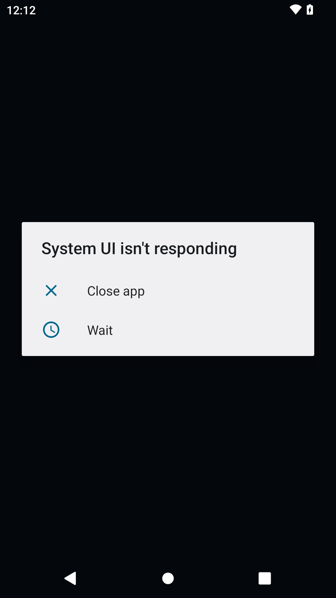
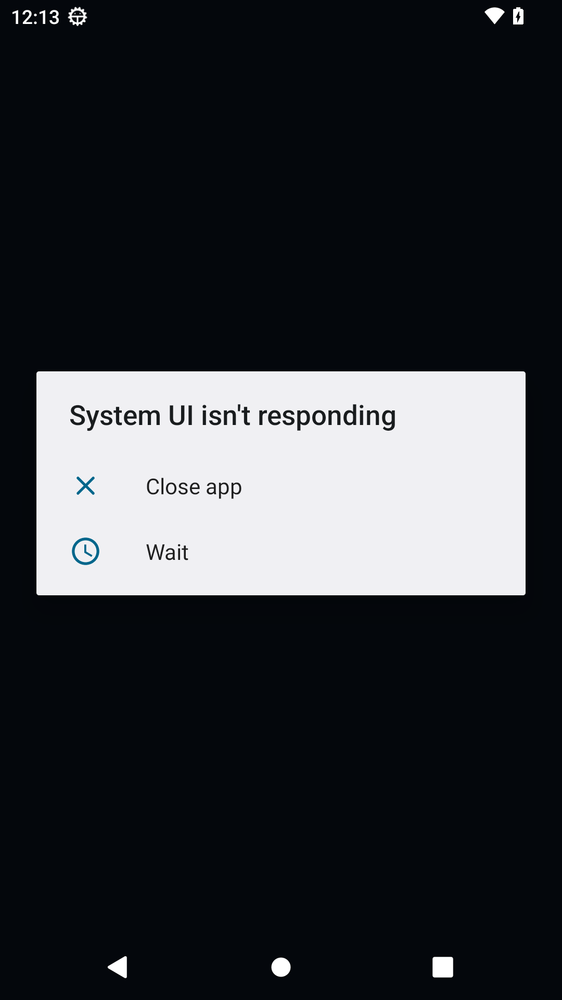

# SYSTIVRA

**Android application ID: `com.brendigo.systivra` (exact, canonical, enforced in CI).**
### Advanced Device Monitor & Diagnostics

**Know your device. Monitor what Android actually reports.**

**A privacy-first Android system information utility, built with real metrics, clear data sources and a premium midnight UI.**

[**Download latest published pre-release**](https://github.com/bren-wp/SYSTIVRA/releases) · [**Explore the website**](website/) · [**View 37 design references**](brending/screens/index.html) · [**Report a problem**](https://github.com/bren-wp/SYSTIVRA/issues)

---

## ✨ Why SYSTIVRA?

Many Android monitoring apps display device numbers without explaining their origin or limitations. SYSTIVRA takes a different approach: **real readings only, explicit availability and a clean native experience.**

- 🚀 **Splash → Dashboard** — no sign-in, registration or onboarding.
- 🌙 **Dark by default** — consistent midnight, electric blue, violet and mint design tokens.
- 🔐 **Privacy-first** — no mandatory internet connection, telemetry or user account.
- ⚡ **Live monitoring** — battery, charging, RAM, storage, thermal state, and optional system CPU load.
- 🧠 **Hardware intelligence** — inspect CPU architecture, OpenGL GPU driver, Android version, display refresh rate and sensors.
- 🩺 **Honest diagnostics** — interactive display/touch and vibration tests with user-confirmed outcomes.
- 📊 **Recording Library** — separate sessions, recorded sample analysis, local CSV/JSON/PDF export and explicit Android Sharesheet, confirmed per-session and all-recordings deletion.
- 📉 **Session Insights** — recorded battery trends and temperature statistics, with unavailable-safe calculations.
- 🔎 **Transparent measurements** — unavailable CPU/GPU temperatures, external FPS and permissions are never invented.
- 🧭 **Actionable hardware metrics** — tap a reference card to inspect its exact real Android reading and source; search readings offline and copy measured values on-device.
- 📈 **RAM usage history** — derived percentage chart from actual available/total RAM readings when a sufficient sample history exists; no invented trend data.
- 🗂️ **Selected session navigation** — History cards select the corresponding private saved session before opening Recording Library.
- 🎮 **Performance Lab** — bounded, cancellable CPU test with a thermal safety cutoff.
- 🧭 **Live sensors** — observe Android-provided axes, units and calibration status.
- 🔔 **Local alerts** — configurable, on-screen battery and thermal thresholds.

## 🎨 Google Play branding

**Current Play listing preparation:** static icon and feature artwork are production-sized; genuine emulator screenshot files exist but the set is **not yet manually approved**. Emulator captures showing Android System UI/Quickstep crashes must never be uploaded. [Strict capture workflow](.github/workflows/android-screenshots.yml) only publishes genuine focused-app images when validation succeeds.

- [**Download the store artwork package**](brending/google-play/assets/SYSTIVRA-Play-Graphics.zip)
- [App icon (512 × 512)](brending/google-play/assets/icon-512.png)
- [Feature graphic (1024 × 500)](brending/google-play/assets/feature-graphic-1024x500.png)
- [English Play listing text](brending/google-play/STORE-LISTING-EN.md)
- [Google Play release readiness checklist](docs/GOOGLE-PLAY-RELEASE-GATE.md)

The eight promotional visuals under `brending/google-play/concepts-NOT-FOR-PLAY/` are **marketing concepts, not screenshots**. The repository also contains eight actual captured Android screens in `brending/google-play/real-screenshots/`, but **they have not passed final manual design review** and must not be submitted to Play on that basis. Capture QA rejects screenshots when SYSTIVRA is not the focused app.

### All 37 original Play-sized design references (NOT screenshots)

- [**Download all 37 reference PNGs — 1080 × 1920 ZIP**](brending/google-play/reference-previews-NOT-PLAY-SCREENSHOTS/SYSTIVRA-37-REFERENCE-PREVIEWS-1080x1920.zip)
- [**See the contact sheet of all 37 screens**](brending/google-play/reference-previews-NOT-PLAY-SCREENSHOTS/ALL-37-REFERENCES-contact-sheet.png)
- [**Source references in SVG**](brending/screens/index.html)

Each PNG preserves its original 390 × 844 SVG content without stretching, with dark side letterboxing to fit 9:16. The source images were reconstructed from earlier design materials and are **not actual Android screenshots**. Google Play screenshots require verified captures of the running `com.brendigo.systivra` app; never upload these design previews as real screens.

The current Android redesign aligns the Dashboard, Hardware Explorer, metric cards and text-only bottom navigation more closely with the SVG reference. **All 37 visual parity gates remain open** until real emulator screenshots, diffs and manual QA are complete.

## 📱 Real Android application screenshots

These are **actual 1080 × 1920 Android emulator captures** checked into the repository by the CI capture pipeline on 15 November 2026 ([provenance commit](https://github.com/bren-wp/SYSTIVRA/commit/2689a7bd495ba4f3fb4d6f3dca68a0cd3605c972)). Unlike the SVG reference gallery below, these PNGs were captured from the running Android application. They document the captured build at that date; **they have not passed final human image review, are not approved Google Play screenshots, and do not certify 1:1 visual parity with the 37 design references**. Dynamic hardware readings may differ by device.

<table>
<tr>
<td align="center"> Dashboard · real capture</td>
<td align="center"> Hardware Explorer · real capture</td>
<td align="center"> Memory · real capture</td>
<td align="center"> Battery · real capture</td>
</tr>
<tr>
<td align="center"> Live Monitor · real capture</td>
<td align="center"> Diagnostics · real capture</td>
<td align="center"> Recordings · real capture</td>
<td align="center"> Insights · real capture</td>
</tr>
</table>

**Visual references are separate:** [37 original SVG screens](brending/screens/index.html) · [37 concept render contact sheet](brending/rendered/systivra-37-screen-contact-sheet.png) · [screen-by-screen verification matrix](docs/SCREEN-STATUS.md). The original vector art is **not** an Android screenshot. For a current release, regenerate genuine captures via [Android screenshot QA](.github/workflows/android-screenshots.yml), reject OS dialogs and manually inspect every image before using it in a store listing.

## 🧩 Supported features and current status

| Area | Current capabilities | Notes |
|---|---|---|
| 🔋 Battery | Level, state, temperature, current where available | Android BatteryManager/broadcast |
| 🧠 RAM | Total, available, derived used memory | ActivityManager |
| 💾 Storage | Available, total and used internal volume | StatFs |
| 🌡️ Thermal | Android platform thermal state (API 29+) | Not a direct CPU temperature |
| 🖥️ System | Model, vendor, OS, architecture and display | Public Android APIs |
| 🧭 Sensors | Inventory and live values from supported sensors | SensorManager |
| 📈 Monitoring | Adjustable foreground sampling, battery chart, opt-in grouped SQLite recording library (900 samples total), analysis and per-session export | Local persistence; no background service |
| 🧪 Diagnostics | User-confirmed display color/touch test with saved result | Camera/microphone/speaker tests not implemented |
| 📄 Reports | CSV/JSON/PDF via Android document picker; explicit Android Sharesheet for text-based CSV | Explicit user action; no uploads |
| 🖥️ GPU / CPU | OpenGL renderer/vendor/version; optional /proc/stat load | Hardware temperature and global GPU load may be unavailable |
| 🧪 Benchmark | Bounded, cancellable 2-second single-worker CPU test | Not comparable with standardized benchmark suites |
| 🌐 Network | Network state and platform bandwidth estimate | ACCESS_NETWORK_STATE only; no Internet permission |
| 🕵️ App usage | Optional local usage statistics | Explicit Android Usage Access required |
| 🎛️ HUD | Interactive in-app preview | Overlay over other apps not implemented |
| 🎨 Visual QA | Reference gallery, pixel-diff tool and UI tokens | Physical capture validation pending |

### Accuracy over fabricated numbers

Android does not guarantee third-party access to all per-core CPU data, GPU usage, FPS in other apps, or CPU/GPU temperatures. When a metric is not available, **SYSTIVRA says “Unavailable”** and explains its source. We never market a simulated score as device health or measured performance.

## 🎨 Design system

| Design token | Value |
|---|---|
| Background | #0B121E |
| Card | #152235 |
| Raised card | #1A2D47 |
| Cyan accent | #29C7FC |
| Purple accent | #8B5CF6 |
| Mint status | #32E5BC |
| Primary text | #F4F8FC |

The Android app and [responsive presentation website](website/) share the same SYSTIVRA identity. A reproducible [Google Play graphic generator](tools/render_google_play.py) creates correctly sized PNGs from the SVG source. The [branding directory](brending/) contains vector logos, launcher assets, 37 English-language concepts and PNG previews.

## 🏗️ Source structure

- **android/** — Kotlin + Jetpack Compose Android client
- **website/** — static, responsive presentation website
- **brending/** — icon, logo, app screen visual references and exported PNG previews
- **docs/** — development roadmap, architecture and visual comparison criteria
- **tools/** — branding exporter and strict screenshot pixel-diff utility
- **.github/workflows/** — reproducible CI checks and preview release automation

## 🚀 Build and install

Requirements: JDK 17, Android SDK Platform 37.0 and Gradle 9.6.0.

From the android directory:

    gradle :app:testDebugUnitTest :app:assembleDebug :app:bundleRelease

The debug APK is produced under android/app/build/outputs/apk/debug; the release AAB under android/app/build/outputs/bundle/release.

**Signing:** development APKs are debug-signed. Without securely provided release signing credentials, the AAB is **unsigned and not ready for Google Play upload**. A signed production build must use the project's private signing key — never put a keystore or credentials in this repository.

## 📦 Versioned releases

**Development candidate: v0.12.0-preview.8 (versionCode 22).** Reports export now provides a focused single-format screen with four accessible CSV/JSON/PDF/Share choices, no automatic scrolling and a direct recording action when history is empty. Recording and Permission reference screens use quick, dismissible status dialogs rather than long scrolls, keeping genuine Android actions, reference design and OS navigation safe areas. [Preview 8 QA and release notes](docs/releases/v0.12.0-preview.8.md). **Independent 37/37 pixel-perfect certification and production signing remain outstanding.**

**Previous preview: v0.12.0-preview.7 (versionCode 21).** SYSTIVRA now keeps each reference screen focused on its four main actions; tapping a metric opens its real reading and source immediately, while nine dedicated searchable browser screens handle detailed Android measurements. Dashboard and Settings avoid long unrelated lists; the tool catalog is searchable. [Preview 7 QA and release notes](docs/releases/v0.12.0-preview.7.md). **No zero-difference 1:1 claim or production AAB signing is made.**

**Previous development preview: v0.12.0-preview.6 (versionCode 20).** The original 62dp tab row remains above Android's own system navigation via a dynamic inset and 8dp gutter; selected tab accessibility and related feature shortcuts are tested. Native SVG color/luminance audits help correct surfaces only where the approved design requires it; 37/37 independent 1:1 approval is still outstanding. [Preview 6 release checks](docs/releases/v0.12.0-preview.6.md). Published assets are available only at [GitHub Releases](https://github.com/bren-wp/SYSTIVRA/releases).

**Earlier v0.12.0-preview.4 (versionCode 18).** **Dark typography and UI contrast:** corrected inherited black/dark labels in all five dialogs, device-search inputs, selected/unselected/disabled Units chips, and Material3 dark cards; calibrated heading/label glyph widths against the original 390×844 SVGs. New WCAG 4.5:1 contrast unit tests, rendered Compose interaction tests, 36/36 native screenshot heading-ink assertions and four real modal/disabled-state captures guard these improvements. [Read the detailed release notes](docs/releases/v0.12.0-preview.4.md).  **Privacy and stability hardening:** bounded recording sample queue, Android 12+ no-transfer rules, masked underlying system errors and a persistent security/dead-code static CI gate are documented in the [18 November audit](docs/AUDIT-2026-11-18.md). Four reference-row symbols now render as consistent native vector icons (not manufacturer-dependent Unicode/emoji), rounded cards have proper pressed feedback, and Settings → Units genuinely saves °C/°F for Android temperature readings without altering recorded/exported values. The battery detail graph uses safe name-based charge-level values. [Previous security audit preview notes](docs/releases/v0.12.0-preview.3.md). Download **debug APK**, **unsigned AAB**, exact source, branding and **38 real emulator screenshots** from GitHub Releases after verification. This remains a development preview, not a certified 1:1 / Play-signed build.

**v0.12.0-preview.1 (versionCode 15)** introduces an SVG-normalized 3D ring/gradient, reference-screen typography corrections (28 checked text baselines), locally generated PDF reports and a corrected battery trend that never substitutes temperature or electrical current for charge. [Read exact release notes](docs/releases/v0.12.0-preview.1.md). The actual Android emulator images in the gallery above remain genuine capture files; they are **not** fresh v0.12 screenshots, nor are they approved Play screenshots. Preview release assets are debug-signed APK and unsigned AAB only; do not use either as a signed Play update.

Every milestone is designed to publish:
- 📱 a clearly labeled debug APK for testing;
- 📦 an unsigned release AAB for later authorized signing;
- 🧾 a complete source ZIP (plus GitHub's automatic source archives);
- 🔒 a SHA-256 checksum file and release notes.

See [Releases](https://github.com/bren-wp/SYSTIVRA/releases) for builds. Preview builds are **not production-certified**. Release automation will not publish artifacts when compilation or unit tests fail.

## 🔎 Security, dead-code and visual QA audit — 18 November 2026

The [full source-level audit and per-screen evidence matrix](docs/AUDIT-2026-11-18.md) covers local recording backpressure, Android 12+ cloud/device-transfer privacy, error-message redaction, permission/export checks, navigation completeness, CSS/Kotlin dead-code candidates and 36 native 390×844 screenshot comparisons. CI runs [the deterministic security/dead-code gate](tools/audit-android-surface.py). This is **not an external security certification, complete transitive CVE scan, or 1:1 design sign-off**. The Play release AAB remains unsigned without the user-controlled upload key.

## 🧪 Quality & roadmap

**v0.9 identity migration:** every Kotlin package, source path, instrumented test, `namespace`, `applicationId` and screenshot test identifier was migrated to `com.brendigo.systivra`. CI refuses builds with mismatched IDs. This creates a **new app identity** in Google Play; installations and local recordings from the old ID do not transfer automatically. Previous preview APKs must not be used to test the new application identity.

**Dependencies:** pinned AGP 9.5.1, Gradle 9.9.1 (security fixes), Kotlin 2.4.21, Compose BOM 2026.09.00, coroutines 1.11.0, Activity 1.13.0, Lifecycle 2.11.0. See [dependency audit](docs/DEPENDENCY-AUDIT-2026-11.md).

Dependency security and version status: [November 2026 stable dependency audit](docs/DEPENDENCY-AUDIT-2026-11.md). Pinned AGP 9.5.1 and AndroidX SplashScreen 1.2.0; optional Usage Access now includes an affirmative explanation before Android system settings.

The [37-screen implementation matrix](docs/SCREEN-STATUS.md) tracks each route and the as-yet unverified 1:1 pixel comparisons. A dedicated [Android emulator capture workflow](.github/workflows/android-screenshots.yml) generates real screenshot evidence; these are not interchangeable with concept images.

Production acceptance requires functional and visual checks across phone/tablet sizes, Android API levels, screen density, font scaling, TalkBack, battery/thermal behavior and real devices. The [visual QA protocol](docs/VISUAL-QA.md) measures actual screen diffs against approved references. **No screen is described as 1:1 until that screen has passed visual comparison.**

Further work includes richer multi-session analysis, cross-app overlay support, additional component tests, broader benchmark coverage, measured visual parity and full security/dead-code review. Unsupported features remain clearly labeled in-app.

## 🔏 Privacy & license

No account is required, no telemetry backend is needed for the core app, and no INTERNET permission is requested in the current Android build (ACCESS_NETWORK_STATE is used only to inspect network status). Live session readings remain in memory; only user-started recordings are saved to a private local SQLite database (up to 900 samples across sessions), without Android backup. CSV/JSON export is initiated by the user.

SYSTIVRA source code is distributed under the [MIT License](LICENSE).

**SYSTIVRA** · Copyright © 2026 **BRENDIGO** · [brendigo.com](https://brendigo.com)

---

Created to help users understand their Android hardware — without guesswork.

