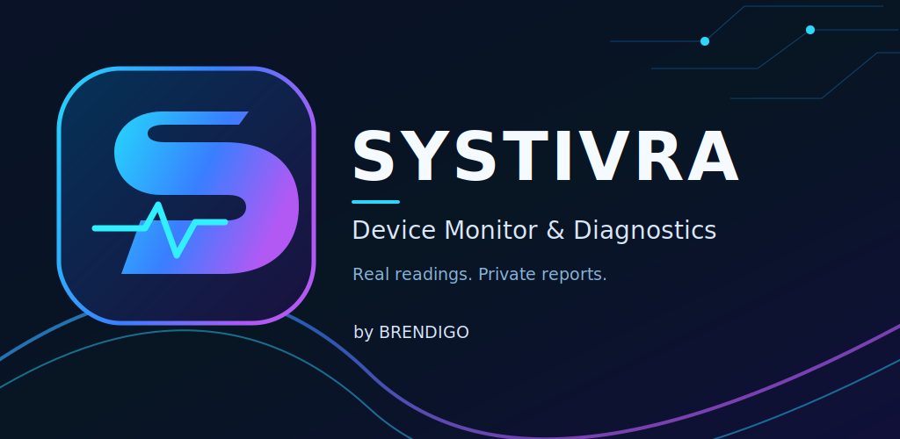
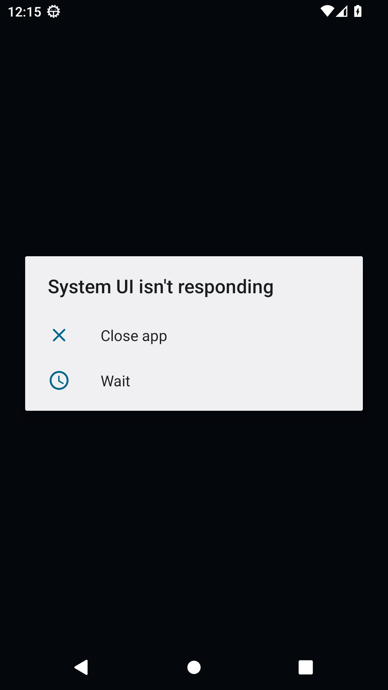
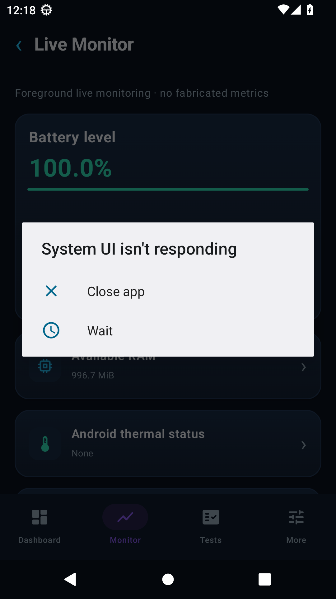
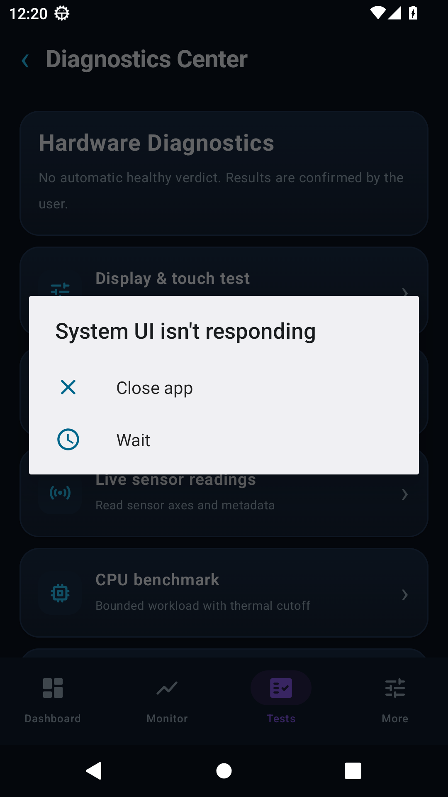

<!-- SYSTIVRA by Brendigo -->
<div align="center">


# SYSTIVRA by Brendigo

### Know your device. See what Android really reports.

**Native Android system monitor • Hardware diagnostics • Private local recordings**


[](https://github.com/bren-wp/SYSTIVRA/actions/workflows/android-ci.yml)

[**Releases & APK**](https://github.com/bren-wp/SYSTIVRA/releases) ·
[**Project website**](website/) ·
[**Original screen references**](brending/screens/index.html) ·
[**Report an issue**](https://github.com/bren-wp/SYSTIVRA/issues)



</div>

---

## Your Android device, explained

SYSTIVRA keeps device information understandable. It displays **actual values returned by Android**, identifies their sources and clearly labels unavailable measurements. No account, automatic data upload or invented scores are needed.

| | What you can do |
|---|---|
| 🔋 **Battery & charging** | Inspect battery level, current when supported, state, temperature and genuine recorded trends |
| 🧠 **CPU, RAM & storage** | See platform details, CPU load when available, real memory readings and storage utilization |
| 🌡️ **Thermal & sensors** | Read Android thermal status and supported live SensorManager signals |
| 🖥️ **Display & GPU** | Inspect density, resolution, refresh rate and supported graphics information |
| 🩺 **Diagnostics** | Run opt-in display/touch, speaker and vibration checks; explicitly confirm outcomes |
| 🎮 **Performance Lab** | Run a short, cancellable CPU microbenchmark with Android thermal safety |
| 📈 **Local recordings** | Start and stop foreground-only capture, review separate sessions, analyze real history |
| 📄 **Reports** | Export selected saved samples to CSV, JSON or PDF, or explicitly use Android Sharesheet |
| 🔔 **Local alerts** | Configure battery thresholds and inspect thermal warnings within the app |
| 🔏 **Privacy controls** | Review permissions and enable optional Usage Access only after explanation |

**Focused navigation:** a screen presents its primary task. Compact panels, tabs and **Previous / Next** controls replace long feeds; short screens retain safe overflow scrolling for actions that cannot otherwise fit. The hardware catalog can be filtered by category or searched offline. Android system navigation remains separated from the app's own bottom menu.

## 📱 Real Android application screenshots

These are genuine Android emulator captures saved in the repository on **15 November 2026**, not AI images, hand-drawn designs or source SVG renderings. They show the build captured on that date; interface details have evolved since then. Newer QA screenshot collections are available with each [published release](https://github.com/bren-wp/SYSTIVRA/releases).

<table>
<tr>
<td align="center"><sub>Dashboard</sub></td>
<td align="center"><sub>Hardware</sub></td>
<td align="center"><sub>Memory</sub></td>
<td align="center"><sub>Battery</sub></td>
</tr>
<tr>
<td align="center"><sub>Live Monitor</sub></td>
<td align="center"><sub>Diagnostics</sub></td>
<td align="center"><sub>Recordings</sub></td>
<td align="center"><sub>Insights</sub></td>
</tr>
</table>

**Latest verified release capture collection (21 November 2026):** [Preview 10 real emulator screenshot ZIP](https://github.com/bren-wp/SYSTIVRA/releases/download/v0.12.0-preview.10/SYSTIVRA-v0.12.0-preview.10-real-Android-emulator-screenshots-NOT-Play-approved.zip). All images are genuine app captures but **not approved** for Google Play and not independently certified pixel-perfect.

The [37 original SVG screen references](brending/screens/index.html) describe the intended visual design, not running app screenshots. [Review the design comparison criteria](docs/VISUAL-QA.md) separately.

## Privacy first

- **No sign-in or tracking SDK.** The Android app does not request the `INTERNET` permission.
- **Foreground-only collection.** Hardware samples are gathered while SYSTIVRA is active.
- **Private local history.** User-started recordings persist in an app-private SQLite database, capped at 900 samples across sessions. Database backup is disabled.
- **Explicit exports only.** CSV, JSON and PDF use Android's file picker; the Android Sharesheet opens only when requested. Source readings are snapshotted before the picker opens so a session change does not silently alter exported content.
- **Honest device support.** A reading unavailable from Android stays `Unavailable` rather than being estimated.

The app requests no camera/microphone recording or floating-window permission. Optional app-usage statistics require a separate Android approval and are processed locally.

## Install and try SYSTIVRA

[**Open GitHub Releases**](https://github.com/bren-wp/SYSTIVRA/releases)

The next release candidate is **v0.12.0-preview.11** (versionCode 25), based on [merged PR #42](https://github.com/bren-wp/SYSTIVRA/pull/42). See [GitHub Releases](https://github.com/bren-wp/SYSTIVRA/releases) for the latest **successfully published** build. The code separates large Kotlin files, uses focused controls and paging, and retains overflow scrolling for short screens. This candidate must pass independent emulator and screenshot checks before publication.

Release assets distinguish the **debug-signed APK** (for installation/testing) from an **unsigned AAB** (not ready for a Google Play upload). Production signing requires a private signing key that must never be committed.

## Built to be maintained

| Area | Main code |
|---|---|
| Android navigation and route orchestration | `android/app/src/main/java/com/brendigo/systivra/ui/AppRoot.kt` |
| Fixed reference-first screens | `ReferenceHomeScreens.kt`, `ReferenceLanding.kt`, `ReferenceDetails.kt` |
| Search, categories and paging | `ScreenCatalog.kt`, `CatalogCategories.kt`, `PagedContent.kt` |
| Monitoring and diagnostics | `MonitoringAndDiagnosticsScreens.kt`, `ComponentTestScreen.kt`, `SystemTools.kt` |
| Recording, reports and analytics | `RecordingStore.kt`, `RecordingScreens.kt`, `ReportsScreen.kt`, `SessionInsightsScreen.kt` |
| Visual QA and repeatable builds | `tools/`, `.github/workflows/`, `docs/` |
| Marketing, brand assets and screen references | `brending/`, `website/` |

All source modules use the SYSTIVRA by Brendigo attribution. Components keep only relevant comments explaining behavior, privacy, compatibility and non-obvious constraints.

### Build from source

Use **JDK 17**, **Android SDK Platform 37.0** and **Gradle 9.9.1**.

```bash
cd android
gradle :app:lintDebug :app:testDebugUnitTest :app:assembleDebug :app:bundleRelease
```

The source pins Kotlin 2.4.21, AGP 9.5.1, a compatible Compose BOM and reviewed stable AndroidX libraries. See the [dependency audit](docs/DEPENDENCY-AUDIT-2026-11.md) for pinning and compatibility decisions.

### Project links

[License (MIT)](LICENSE) · [Changelog](CHANGELOG.md) · [Preview 11 notes](docs/releases/v0.12.0-preview.11.md) · [Source security audit](docs/AUDIT-2026-11-18.md) · [Android UI QA](docs/VISUAL-QA.md) · [Google Play readiness](docs/GOOGLE-PLAY-RELEASE-GATE.md)

Visual QA, physical Android device testing, complete third-party security review and production signing remain separate acceptance gates. An automated green build alone does not establish 1:1 pixel identity across all 37 reference screens.

<div align="center">


<sub>© 2026 Brendigo · Privacy-conscious Android diagnostics · MIT License</sub>
</div>
