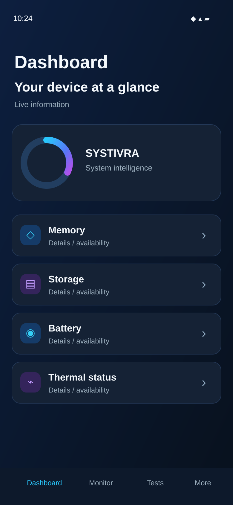
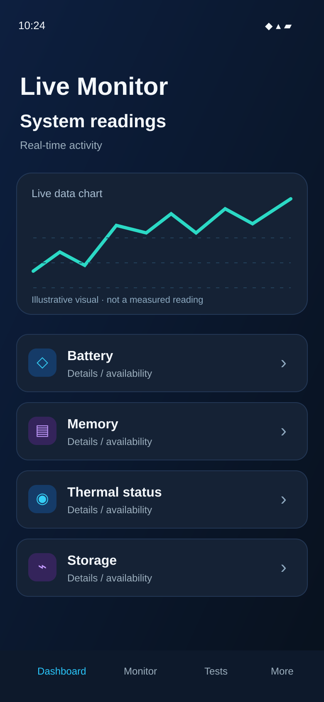
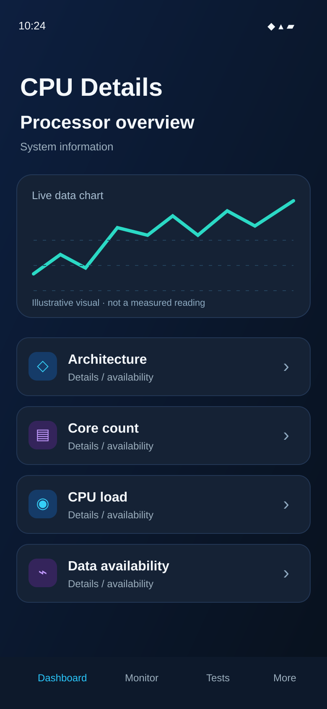
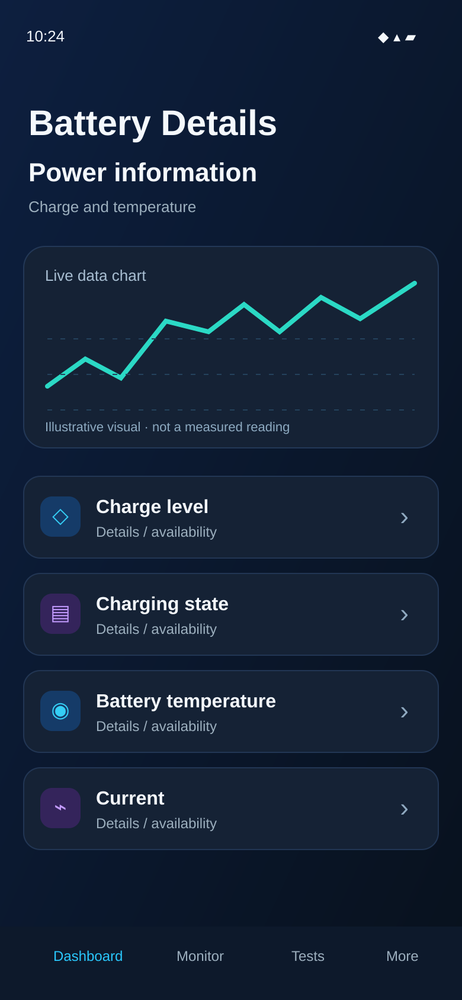
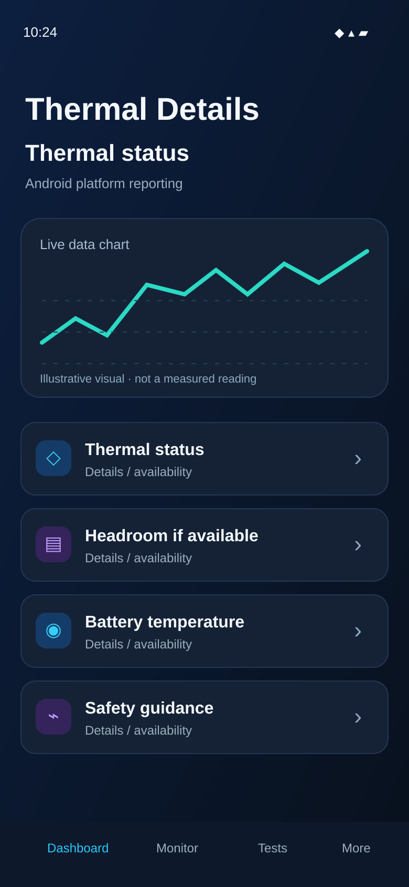
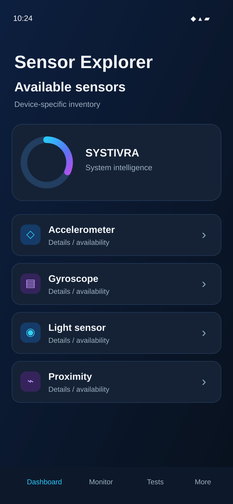
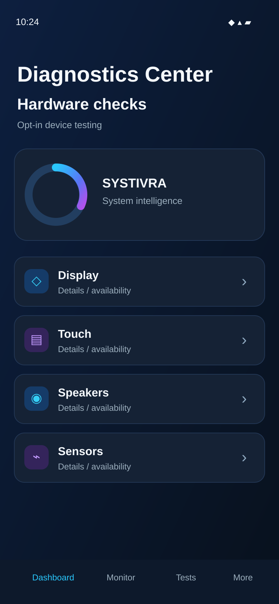
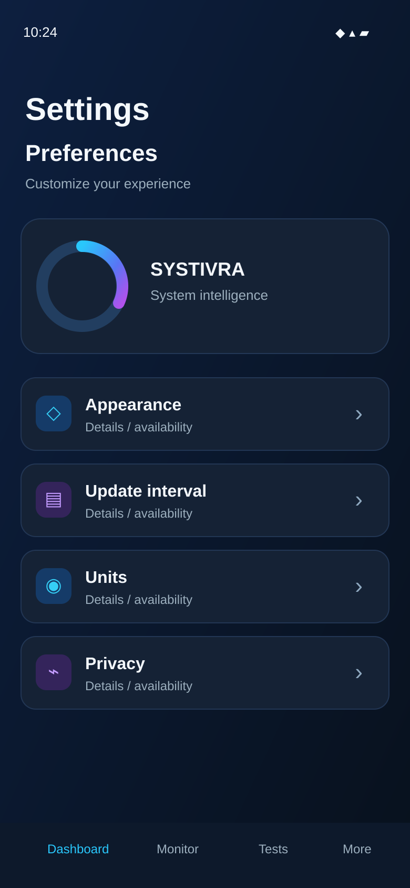

# SYSTIVRA
### Advanced Device Monitor & Diagnostics

**Know your device. Monitor what Android actually reports.**

**A privacy-first Android system information utility, built with real metrics, clear data sources and a premium midnight UI.**

[**Download pre-release**](https://github.com/bren-wp/SYSTIVRA/releases) · [**Explore the website**](website/) · [**View 37 design references**](brending/screens/index.html) · [**Report a problem**](https://github.com/bren-wp/SYSTIVRA/issues)

---

## ✨ Why SYSTIVRA?

Many Android monitoring apps display device numbers without explaining their origin or limitations. SYSTIVRA takes a different approach: **real readings only, explicit availability and a clean native experience.**

- 🚀 **Splash → Dashboard** — no sign-in, registration or onboarding.
- 🌙 **Dark by default** — consistent midnight, electric blue, violet and mint design tokens.
- 🔐 **Privacy-first** — no mandatory internet connection, telemetry or user account.
- ⚡ **Live monitoring** — battery, charging, RAM, storage, thermal state, and optional system CPU load.
- 🧠 **Hardware intelligence** — inspect CPU architecture, OpenGL GPU driver, Android version, display refresh rate and sensors.
- 🩺 **Honest diagnostics** — interactive display/touch and vibration tests with user-confirmed outcomes.
- 📊 **Recording Library** — separate sessions, recorded sample analysis, local CSV/JSON export, safe per-session deletion.
- 📉 **Session Insights** — recorded battery trends and temperature statistics, with unavailable-safe calculations.
- 🔎 **Transparent measurements** — unavailable CPU/GPU temperatures, external FPS and permissions are never invented.
- 🎮 **Performance Lab** — bounded, cancellable CPU test with a thermal safety cutoff.
- 🧭 **Live sensors** — observe Android-provided axes, units and calibration status.
- 🔔 **Local alerts** — configurable, on-screen battery and thermal thresholds.

## 📱 App gallery

**SYSTIVRA dashboard and system insights**

<table>
<tr>
<td align="center"> Dashboard</td>
<td align="center"> Live Monitor</td>
<td align="center"> CPU Details</td>
<td align="center"> Battery</td>
</tr>
<tr>
<td align="center"> Thermal</td>
<td align="center"> Sensors</td>
<td align="center"> Diagnostics</td>
<td align="center"> Settings</td>
</tr>
</table>

**[Explore the full 37-screen contact sheet](brending/rendered/systivra-37-screen-contact-sheet.png)**

Visuals above are **design concept exports**, not captured Android emulator screenshots. A pixel-perfect 1:1 match remains a measurable development goal, not a verified claim.

## 🧩 Supported features and current status

| Area | Current capabilities | Notes |
|---|---|---|
| 🔋 Battery | Level, state, temperature, current where available | Android BatteryManager/broadcast |
| 🧠 RAM | Total, available, derived used memory | ActivityManager |
| 💾 Storage | Available, total and used internal volume | StatFs |
| 🌡️ Thermal | Android platform thermal state (API 29+) | Not a direct CPU temperature |
| 🖥️ System | Model, vendor, OS, architecture and display | Public Android APIs |
| 🧭 Sensors | Inventory and live values from supported sensors | SensorManager |
| 📈 Monitoring | Adjustable foreground sampling, battery chart, opt-in grouped SQLite recording library (900 samples total), analysis and per-session export | Local persistence; no background service |
| 🧪 Diagnostics | User-confirmed display color/touch test with saved result | Camera/microphone/speaker tests not implemented |
| 📄 Reports | CSV and JSON export via Android file picker | Explicit user action; no uploads |
| 🖥️ GPU / CPU | OpenGL renderer/vendor/version; optional /proc/stat load | Hardware temperature and global GPU load may be unavailable |
| 🧪 Benchmark | Bounded, cancellable 2-second single-worker CPU test | Not comparable with standardized benchmark suites |
| 🌐 Network | Network state and platform bandwidth estimate | ACCESS_NETWORK_STATE only; no Internet permission |
| 🕵️ App usage | Optional local usage statistics | Explicit Android Usage Access required |
| 🎛️ HUD | Interactive in-app preview | Overlay over other apps not implemented |
| 🎨 Visual QA | Reference gallery, pixel-diff tool and UI tokens | Physical capture validation pending |

### Accuracy over fabricated numbers

Android does not guarantee third-party access to all per-core CPU data, GPU usage, FPS in other apps, or CPU/GPU temperatures. When a metric is not available, **SYSTIVRA says “Unavailable”** and explains its source. We never market a simulated score as device health or measured performance.

## 🎨 Design system

| Design token | Value |
|---|---|
| Background | #0B121E |
| Card | #152235 |
| Raised card | #1A2D47 |
| Cyan accent | #29C7FC |
| Purple accent | #8B5CF6 |
| Mint status | #32E5BC |
| Primary text | #F4F8FC |

The Android app and [responsive presentation website](website/) share the same SYSTIVRA identity. The [branding directory](brending/) contains vector logos, launcher assets, 37 English-language concepts and PNG previews.

## 🏗️ Source structure

- **android/** — Kotlin + Jetpack Compose Android client
- **website/** — static, responsive presentation website
- **brending/** — icon, logo, app screen visual references and exported PNG previews
- **docs/** — development roadmap, architecture and visual comparison criteria
- **tools/** — branding exporter and strict screenshot pixel-diff utility
- **.github/workflows/** — reproducible CI checks and preview release automation

## 🚀 Build and install

Requirements: JDK 17, Android SDK Platform 37.0 and Gradle 9.6.0.

From the android directory:

    gradle :app:testDebugUnitTest :app:assembleDebug :app:bundleRelease

The debug APK is produced under android/app/build/outputs/apk/debug; the release AAB under android/app/build/outputs/bundle/release.

**Signing:** development APKs are debug-signed. Without securely provided release signing credentials, the AAB is **unsigned and not ready for Google Play upload**. A signed production build must use the project's private signing key — never put a keystore or credentials in this repository.

## 📦 Versioned releases

Every milestone is designed to publish:
- 📱 a clearly labeled debug APK for testing;
- 📦 an unsigned release AAB for later authorized signing;
- 🧾 a complete source ZIP (plus GitHub's automatic source archives);
- 🔒 a SHA-256 checksum file and release notes.

See [Releases](https://github.com/bren-wp/SYSTIVRA/releases) for builds. Preview builds are **not production-certified**. Release automation will not publish artifacts when compilation or unit tests fail.

## 🧪 Quality & roadmap

The [37-screen implementation matrix](docs/SCREEN-STATUS.md) tracks each route and the as-yet unverified 1:1 pixel comparisons. A dedicated [Android emulator capture workflow](.github/workflows/android-screenshots.yml) generates real screenshot evidence; these are not interchangeable with concept images.

Production acceptance requires functional and visual checks across phone/tablet sizes, Android API levels, screen density, font scaling, TalkBack, battery/thermal behavior and real devices. The [visual QA protocol](docs/VISUAL-QA.md) measures actual screen diffs against approved references. **No screen is described as 1:1 until that screen has passed visual comparison.**

Further work includes richer multi-session analysis, cross-app overlay support, additional component tests, broader benchmark coverage, measured visual parity and full security/dead-code review. Unsupported features remain clearly labeled in-app.

## 🔏 Privacy & license

No account is required, no telemetry backend is needed for the core app, and no INTERNET permission is requested in the current Android build (ACCESS_NETWORK_STATE is used only to inspect network status). Live session readings remain in memory; only user-started recordings are saved to a private local SQLite database (up to 900 samples across sessions), without Android backup. CSV/JSON export is initiated by the user.

SYSTIVRA source code is distributed under the [MIT License](LICENSE).

**SYSTIVRA** · Copyright © 2026 **BRENDIGO** · [brendigo.com](https://brendigo.com)

---

Created to help users understand their Android hardware — without guesswork.

