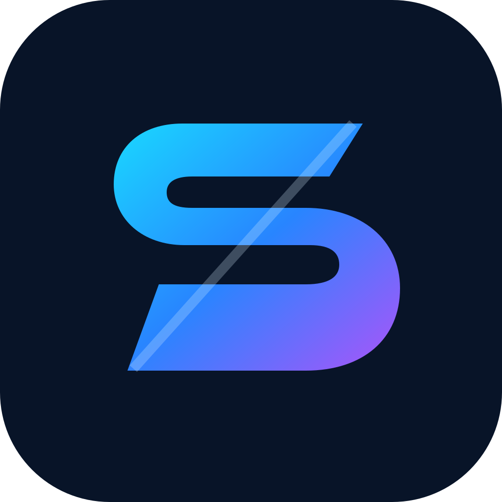
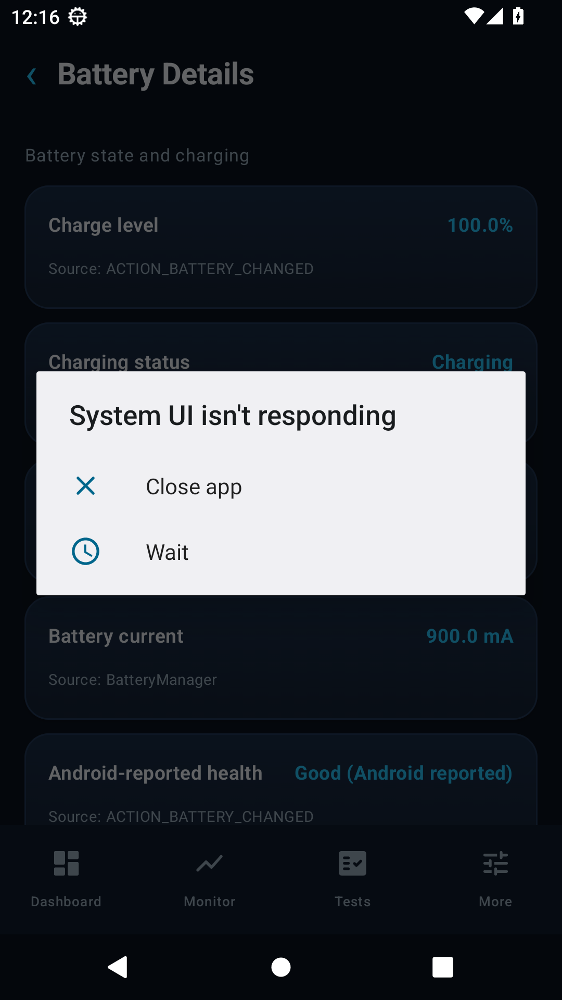
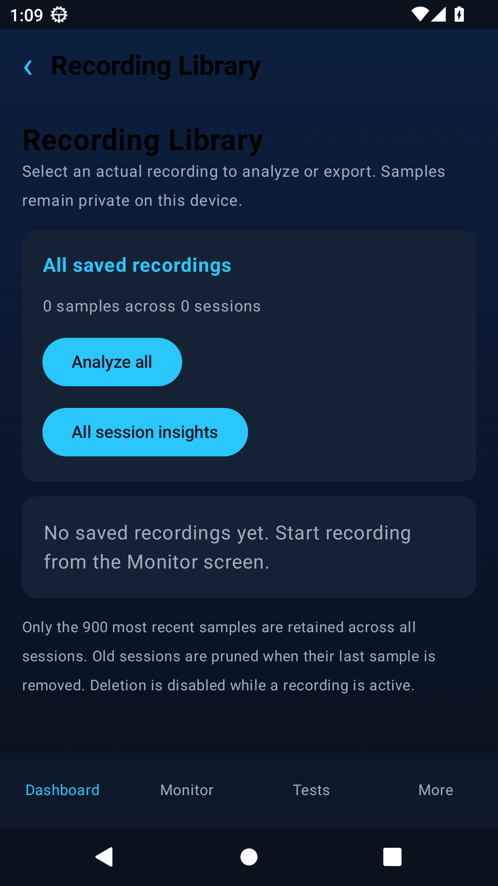
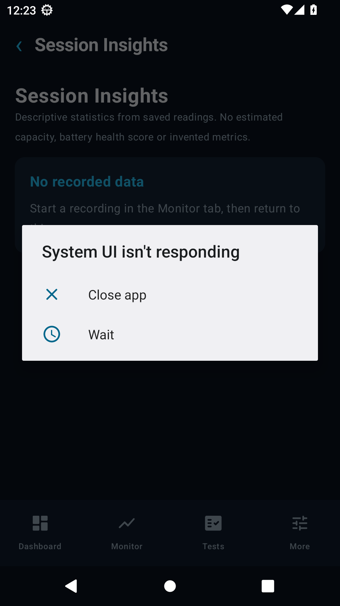

# SYSTIVRA

**Android application ID: `com.brendigo.systivra` (exact, canonical, enforced in CI).**
### Advanced Device Monitor & Diagnostics

**Know your device. Monitor what Android actually reports.**

**A privacy-first Android system information utility, built with real metrics, clear data sources and a premium midnight UI.**

[**Download pre-release**](https://github.com/bren-wp/SYSTIVRA/releases) · [**Explore the website**](website/) · [**View 37 design references**](brending/screens/index.html) · [**Report a problem**](https://github.com/bren-wp/SYSTIVRA/issues)

---

## ✨ Why SYSTIVRA?

Many Android monitoring apps display device numbers without explaining their origin or limitations. SYSTIVRA takes a different approach: **real readings only, explicit availability and a clean native experience.**

- 🚀 **Splash → Dashboard** — no sign-in, registration or onboarding.
- 🌙 **Dark by default** — consistent midnight, electric blue, violet and mint design tokens.
- 🔐 **Privacy-first** — no mandatory internet connection, telemetry or user account.
- ⚡ **Live monitoring** — battery, charging, RAM, storage, thermal state, and optional system CPU load.
- 🧠 **Hardware intelligence** — inspect CPU architecture, OpenGL GPU driver, Android version, display refresh rate and sensors.
- 🩺 **Honest diagnostics** — interactive display/touch and vibration tests with user-confirmed outcomes.
- 📊 **Recording Library** — separate sessions, recorded sample analysis, local CSV/JSON export, confirmed per-session and all-recordings deletion.
- 📉 **Session Insights** — recorded battery trends and temperature statistics, with unavailable-safe calculations.
- 🔎 **Transparent measurements** — unavailable CPU/GPU temperatures, external FPS and permissions are never invented.
- 🧭 **Actionable hardware metrics** — tap a reference card to inspect its exact real Android reading and source; search readings offline and copy measured values on-device.
- 📈 **RAM usage history** — derived percentage chart from actual available/total RAM readings when a sufficient sample history exists; no invented trend data.
- 🗂️ **Selected session navigation** — History cards select the corresponding private saved session before opening Recording Library.
- 🎮 **Performance Lab** — bounded, cancellable CPU test with a thermal safety cutoff.
- 🧭 **Live sensors** — observe Android-provided axes, units and calibration status.
- 🔔 **Local alerts** — configurable, on-screen battery and thermal thresholds.

## 🎨 Google Play branding

**Current Play listing preparation:** static icon and feature artwork are production-sized; genuine emulator screenshot files exist but the set is **not yet manually approved**. Emulator captures showing Android System UI/Quickstep crashes must never be uploaded. [Strict capture workflow](.github/workflows/android-screenshots.yml) only publishes genuine focused-app images when validation succeeds.

- [**Download the store artwork package**](brending/google-play/assets/SYSTIVRA-Play-Graphics.zip)
- [App icon (512 × 512)](brending/google-play/assets/icon-512.png)
- [Feature graphic (1024 × 500)](brending/google-play/assets/feature-graphic-1024x500.png)
- [English Play listing text](brending/google-play/STORE-LISTING-EN.md)
- [Google Play release readiness checklist](docs/GOOGLE-PLAY-RELEASE-GATE.md)

The eight promotional visuals under `brending/google-play/concepts-NOT-FOR-PLAY/` are **marketing concepts, not screenshots**. The repository also contains eight actual captured Android screens in `brending/google-play/real-screenshots/`, but **they have not passed final manual design review** and must not be submitted to Play on that basis. Capture QA rejects screenshots when SYSTIVRA is not the focused app.

### All 37 original Play-sized design references (NOT screenshots)

- [**Download all 37 reference PNGs — 1080 × 1920 ZIP**](brending/google-play/reference-previews-NOT-PLAY-SCREENSHOTS/SYSTIVRA-37-REFERENCE-PREVIEWS-1080x1920.zip)
- [**See the contact sheet of all 37 screens**](brending/google-play/reference-previews-NOT-PLAY-SCREENSHOTS/ALL-37-REFERENCES-contact-sheet.png)
- [**Source references in SVG**](brending/screens/index.html)

Each PNG preserves its original 390 × 844 SVG content without stretching, with dark side letterboxing to fit 9:16. The source images were reconstructed from earlier design materials and are **not actual Android screenshots**. Google Play screenshots require verified captures of the running `com.brendigo.systivra` app; never upload these design previews as real screens.

The current Android redesign aligns the Dashboard, Hardware Explorer, metric cards and text-only bottom navigation more closely with the SVG reference. **All 37 visual parity gates remain open** until real emulator screenshots, diffs and manual QA are complete.

## 📱 Real Android application screenshots

These are **actual 1080 × 1920 Android emulator captures** checked into the repository by the CI capture pipeline on 15 November 2026 ([provenance commit](https://github.com/bren-wp/SYSTIVRA/commit/2689a7bd495ba4f3fb4d6f3dca68a0cd3605c972)). Unlike the SVG reference gallery below, these PNGs were captured from the running Android application. They document the captured build at that date; **they have not passed final human image review, are not approved Google Play screenshots, and do not certify 1:1 visual parity with the 37 design references**. Dynamic hardware readings may differ by device.

<table>
<tr>
<td align="center"> Dashboard · real capture</td>
<td align="center"> Hardware Explorer · real capture</td>
<td align="center"> Memory · real capture</td>
<td align="center"> Battery · real capture</td>
</tr>
<tr>
<td align="center"> Live Monitor · real capture</td>
<td align="center"> Diagnostics · real capture</td>
<td align="center"> Recordings · real capture</td>
<td align="center"> Insights · real capture</td>
</tr>
</table>

**Visual references are separate:** [37 original SVG screens](brending/screens/index.html) · [37 concept render contact sheet](brending/rendered/systivra-37-screen-contact-sheet.png) · [screen-by-screen verification matrix](docs/SCREEN-STATUS.md). The original vector art is **not** an Android screenshot. For a current release, regenerate genuine captures via [Android screenshot QA](.github/workflows/android-screenshots.yml), reject OS dialogs and manually inspect every image before using it in a store listing.

## 🧩 Supported features and current status

| Area | Current capabilities | Notes |
|---|---|---|
| 🔋 Battery | Level, state, temperature, current where available | Android BatteryManager/broadcast |
| 🧠 RAM | Total, available, derived used memory | ActivityManager |
| 💾 Storage | Available, total and used internal volume | StatFs |
| 🌡️ Thermal | Android platform thermal state (API 29+) | Not a direct CPU temperature |
| 🖥️ System | Model, vendor, OS, architecture and display | Public Android APIs |
| 🧭 Sensors | Inventory and live values from supported sensors | SensorManager |
| 📈 Monitoring | Adjustable foreground sampling, battery chart, opt-in grouped SQLite recording library (900 samples total), analysis and per-session export | Local persistence; no background service |
| 🧪 Diagnostics | User-confirmed display color/touch test with saved result | Camera/microphone/speaker tests not implemented |
| 📄 Reports | CSV and JSON export via Android file picker | Explicit user action; no uploads |
| 🖥️ GPU / CPU | OpenGL renderer/vendor/version; optional /proc/stat load | Hardware temperature and global GPU load may be unavailable |
| 🧪 Benchmark | Bounded, cancellable 2-second single-worker CPU test | Not comparable with standardized benchmark suites |
| 🌐 Network | Network state and platform bandwidth estimate | ACCESS_NETWORK_STATE only; no Internet permission |
| 🕵️ App usage | Optional local usage statistics | Explicit Android Usage Access required |
| 🎛️ HUD | Interactive in-app preview | Overlay over other apps not implemented |
| 🎨 Visual QA | Reference gallery, pixel-diff tool and UI tokens | Physical capture validation pending |

### Accuracy over fabricated numbers

Android does not guarantee third-party access to all per-core CPU data, GPU usage, FPS in other apps, or CPU/GPU temperatures. When a metric is not available, **SYSTIVRA says “Unavailable”** and explains its source. We never market a simulated score as device health or measured performance.

## 🎨 Design system

| Design token | Value |
|---|---|
| Background | #0B121E |
| Card | #152235 |
| Raised card | #1A2D47 |
| Cyan accent | #29C7FC |
| Purple accent | #8B5CF6 |
| Mint status | #32E5BC |
| Primary text | #F4F8FC |

The Android app and [responsive presentation website](website/) share the same SYSTIVRA identity. A reproducible [Google Play graphic generator](tools/render_google_play.py) creates correctly sized PNGs from the SVG source. The [branding directory](brending/) contains vector logos, launcher assets, 37 English-language concepts and PNG previews.

## 🏗️ Source structure

- **android/** — Kotlin + Jetpack Compose Android client
- **website/** — static, responsive presentation website
- **brending/** — icon, logo, app screen visual references and exported PNG previews
- **docs/** — development roadmap, architecture and visual comparison criteria
- **tools/** — branding exporter and strict screenshot pixel-diff utility
- **.github/workflows/** — reproducible CI checks and preview release automation

## 🚀 Build and install

Requirements: JDK 17, Android SDK Platform 37.0 and Gradle 9.6.0.

From the android directory:

    gradle :app:testDebugUnitTest :app:assembleDebug :app:bundleRelease

The debug APK is produced under android/app/build/outputs/apk/debug; the release AAB under android/app/build/outputs/bundle/release.

**Signing:** development APKs are debug-signed. Without securely provided release signing credentials, the AAB is **unsigned and not ready for Google Play upload**. A signed production build must use the project's private signing key — never put a keystore or credentials in this repository.

## 📦 Versioned releases

Every milestone is designed to publish:
- 📱 a clearly labeled debug APK for testing;
- 📦 an unsigned release AAB for later authorized signing;
- 🧾 a complete source ZIP (plus GitHub's automatic source archives);
- 🔒 a SHA-256 checksum file and release notes.

See [Releases](https://github.com/bren-wp/SYSTIVRA/releases) for builds. Preview builds are **not production-certified**. Release automation will not publish artifacts when compilation or unit tests fail.

## 🧪 Quality & roadmap

**v0.9 identity migration:** every Kotlin package, source path, instrumented test, `namespace`, `applicationId` and screenshot test identifier was migrated to `com.brendigo.systivra`. CI refuses builds with mismatched IDs. This creates a **new app identity** in Google Play; installations and local recordings from the old ID do not transfer automatically. Previous preview APKs must not be used to test the new application identity.

**Dependencies:** stable AGP 9.4.0, Gradle 9.9.1 (security fixes), Kotlin 2.4.21, Compose BOM 2026.09.00, coroutines 1.11.0, Activity 1.13.0, Lifecycle 2.11.0. See [dependency audit](docs/DEPENDENCY-AUDIT-2026-11.md).

Dependency security and version status: [November 2026 stable dependency audit](docs/DEPENDENCY-AUDIT-2026-11.md). Stable AGP 9.4.0 and AndroidX SplashScreen 1.2.0; optional Usage Access now includes an affirmative explanation before Android system settings.

The [37-screen implementation matrix](docs/SCREEN-STATUS.md) tracks each route and the as-yet unverified 1:1 pixel comparisons. A dedicated [Android emulator capture workflow](.github/workflows/android-screenshots.yml) generates real screenshot evidence; these are not interchangeable with concept images.

Production acceptance requires functional and visual checks across phone/tablet sizes, Android API levels, screen density, font scaling, TalkBack, battery/thermal behavior and real devices. The [visual QA protocol](docs/VISUAL-QA.md) measures actual screen diffs against approved references. **No screen is described as 1:1 until that screen has passed visual comparison.**

Further work includes richer multi-session analysis, cross-app overlay support, additional component tests, broader benchmark coverage, measured visual parity and full security/dead-code review. Unsupported features remain clearly labeled in-app.

## 🔏 Privacy & license

No account is required, no telemetry backend is needed for the core app, and no INTERNET permission is requested in the current Android build (ACCESS_NETWORK_STATE is used only to inspect network status). Live session readings remain in memory; only user-started recordings are saved to a private local SQLite database (up to 900 samples across sessions), without Android backup. CSV/JSON export is initiated by the user.

SYSTIVRA source code is distributed under the [MIT License](LICENSE).

**SYSTIVRA** · Copyright © 2026 **BRENDIGO** · [brendigo.com](https://brendigo.com)

---

Created to help users understand their Android hardware — without guesswork.

